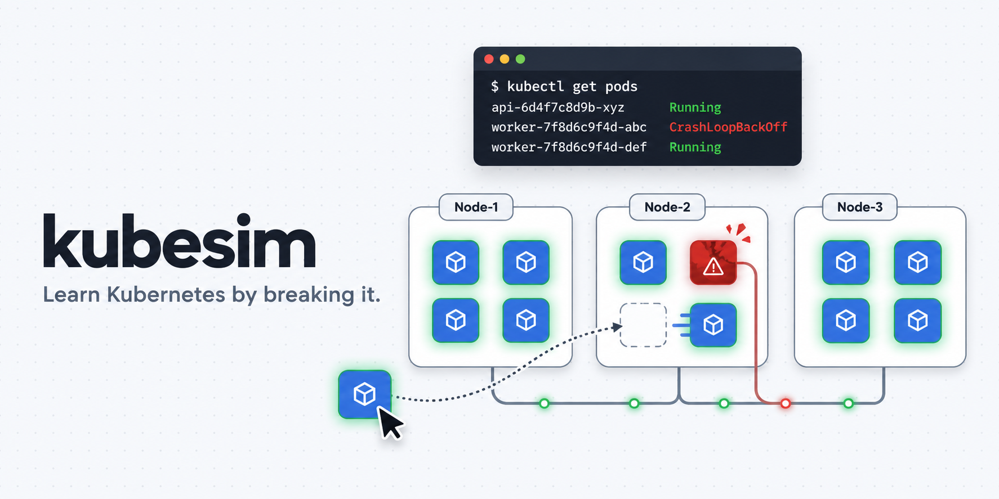
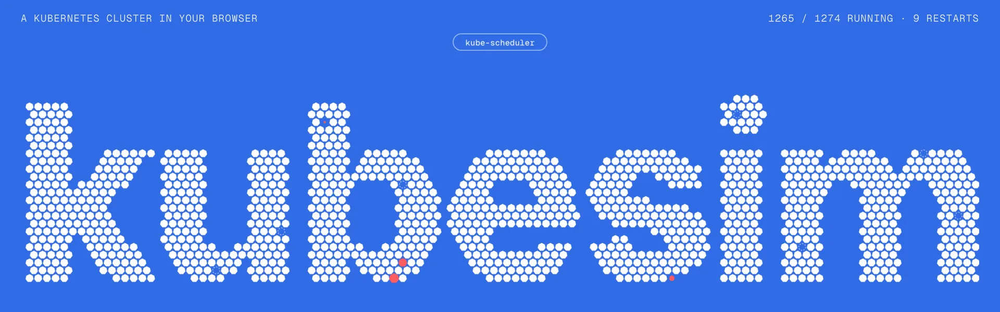
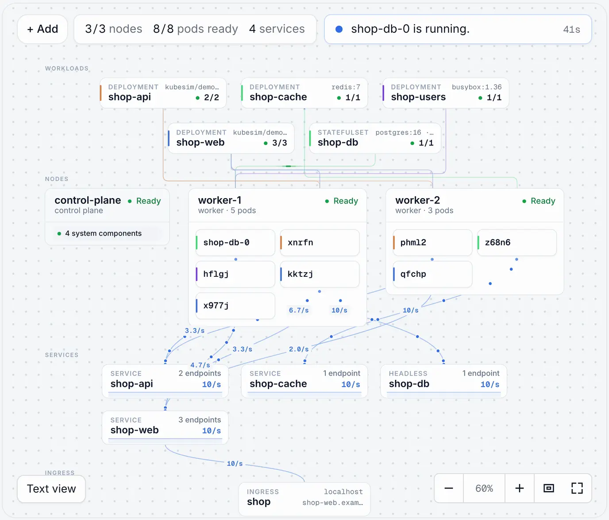

<div align="center">

<a href="https://kubesim.app"></a>

A simulated Kubernetes cluster runs in your browser tab. Break it on purpose, watch it heal, and see the `kubectl` behind every click.

[](https://kubesim.app)

[](https://github.com/Sharathchenna/kubesim/actions/workflows/ci.yml)
[](LICENSE)


[Lessons](https://kubesim.app/learn) · [Incidents](https://kubesim.app/incidents) · [Daily Incident](https://kubesim.app/daily) · [Challenges](https://kubesim.app/challenges) · [Practice exams](https://kubesim.app/exams) · [Sandbox](https://kubesim.app/sandbox)

</div>

<br>



Most people learn Kubernetes from diagrams of a cluster they never get to touch. kubesim gives you one you can see. You type real `kubectl` commands, or drag things around, and watch Pods get scheduled, crash, heal and roll out, with every step explained in plain English.

It's free and open source, and there's nothing to install: no sign-up, no cloud account, no backend. Everything runs in your tab.

## Break it in 30 seconds

Open the [Sandbox](https://kubesim.app/sandbox), press **Add the shop** (web, API, Postgres, Redis), and try one of these:

| Do this | What you'll see |
|---|---|
| Drag a **Pod** onto a Node and pick *"runs out of memory"* | It goes `OOMKilled`, then `CrashLoopBackOff`. Click it: the sidebar says what's wrong and offers the fix, with the command it runs. |
| Pick **Presets → Launch day** on the traffic bar | Errors climb as the shop drowns. Click **Why?** to find the bottleneck, then let an HPA scale it back to 0% errors. |
| Click a **Node** and press **Simulate failure** | It stops responding, its Pods are evicted and rescheduled onto the others. |
| `kubectl delete pod` the database | Errors travel up the request chain in red, then the Deployment brings it back. |
| Hover a Deployment and press **+** | It scales, and the terminal shows the `kubectl scale` it ran. |



## What's inside

| | |
|---|---|
| 📚 **[Lessons](https://kubesim.app/learn)** | 19 hands-on lessons in seven tracks, from your first Pod through health checks, Jobs, config, Ingress, NetworkPolicy, storage, StatefulSets, scheduling, autoscaling and RBAC. Each gives you a fresh cluster, a terminal and a YAML editor. Steps tick off by themselves once you've done them; most Checks look at the cluster's state, not at what you typed. |
| 🚨 **[Incidents](https://kubesim.app/incidents)** | 16 outages. You're on call: a shop with live traffic is down, the pager shows the error rate, and the clock runs until you find the cause with kubectl and fix it. The **[Daily Incident](https://kubesim.app/daily)** is the same outage for everyone each day, with a streak and a result to share. |
| 🧩 **[Challenges](https://kubesim.app/challenges)** | 30 broken clusters and a goal, with no instructions: find the cause with kubectl and fix it. Hints and the fix stay hidden until you ask. |
| ⏱️ **[Practice exams](https://kubesim.app/exams)** | Unofficial, timed task lists in the style of the CKAD™ and CKA™ exams, graded from the cluster's state, with solutions afterwards. |
| 🎬 **[Explainers](https://kubesim.app/explainers)** | 11 narrated scenarios (self-healing, scaling, rolling updates, Services, Node failure, CrashLoopBackOff, probes, autoscaling, StatefulSets, Ingress, NetworkPolicy) that play step by step on the live cluster. |
| 🔍 **[Concepts](https://kubesim.app/concepts)** | Step-through illustrations: how a cluster is built, what happens on `kubectl apply`, how a Service routes traffic, how probes, Ingress, NetworkPolicy, volumes, the HPA and RBAC work. They also appear inside the Lessons. |
| 🛠️ **[Sandbox](https://kubesim.app/sandbox)** | Free play. Deploy, scale, roll out, delete anything, power Nodes off and on, cordon and drain. Drop a Pod on a Node and it asks what to run: more of what's already running, a debug shell, a load sender, or something broken on purpose. Select anything and the sidebar says what's wrong with it and how to fix it. Send traffic at the shop and find the bottleneck. **+ Add** drops in building blocks (a web app, an API, PostgreSQL, MySQL, Redis, a load generator, a whole full-stack app) as real manifests you can open and edit. **Share** copies a link that opens a copy of your cluster. |
| 📈 **[Progress](https://kubesim.app/progress)** | What you've finished, on this device only (there are no accounts). |

It's a simulation built for learning, not a real cluster: there's no Helm, no CRDs and no interactive shell, and some corners are simpler than the real thing. What it does simulate is pinned by tests against real Kubernetes behaviour ([details below](#whats-simulated)).

## Run it

Needs [Bun](https://bun.sh).

```bash
git clone https://github.com/Sharathchenna/kubesim && cd kubesim
bun install
bun run dev        # http://localhost:3000
```

<details>
<summary><b>All the scripts</b></summary>

```bash
bun run test       # engine, kubectl and "every Lesson, Challenge and exam is solvable" tests
bun run build      # static site in out/, deployable to any static host
bun start          # serves out/ on http://localhost:4173, like a static host would (run build first)
bun run e2e        # Playwright tests against out/ (run build first; bunx playwright install chromium once)
bun run demo       # the Simulated Cluster in your terminal, no browser
bun scripts/icons.tsx      # regenerates app/favicon.ico, public/apple-touch-icon.png and public/og.png
bun lib/lessons/gen-meta.ts  # regenerates the index pages' Lesson/Challenge/exam/Explainer metadata
```

</details>

### Deploying

`bun run build` writes a plain static site to `out/`; upload it to any static host. Set `NEXT_PUBLIC_SITE_URL` at build time to the site's public origin, with no trailing slash (for example `NEXT_PUBLIC_SITE_URL=https://kubesim.example.org bun run build`). Canonical URLs, the sitemap, `robots.txt` and the social cards are built from it. It defaults to `https://www.kubesim.app` (see `lib/site.ts`).

## How it works

```
lib/engine/        the Simulated Cluster: an in-memory API server (admission,
                   validation, RBAC), a simulated clock, controllers (kubelet with
                   probes, scheduler, ReplicaSet, Deployment, StatefulSet,
                   DaemonSet, Job, CronJob, HPA, metrics-server, storage,
                   node lifecycle, endpoints, garbage collection), networking
                   (DNS, Services, Ingress, NetworkPolicy) and a tiny container
                   filesystem + shell for exec, probes and container programs
lib/kubectl/       command parsing, printers (tables, describe, -o yaml/json/
                   jsonpath/custom-columns), generators (--dry-run), apply
lib/sim/           browser runtime: SimStore (ticks the engine each animation
                   frame), actions, event narration, shared links
lib/lessons/       Lessons, Challenges, practice exams and their Checks
lib/explainers/    Explainer scripts
components/sim/    Cluster View (2D SVG), terminal, YAML editor, inspector
components/learn/  Lesson and Explainer players, index pages
components/illustrations/  Concept Illustrations
app/               Next.js routes, exported as static HTML
```

The engine is plain, deterministic TypeScript: the same seed and the same commands always give the same cluster. Timings, defaults and messages are modelled on real Kubernetes (v1.37); the sources are in [docs/research/kubernetes-behaviour-reference.md](docs/research/kubernetes-behaviour-reference.md). Two decisions shape the whole design:

- [ADR 0001: the cluster is simulated in the browser](docs/adr/0001-simulated-cluster-in-browser.md)
- [ADR 0002: we write our own engine](docs/adr/0002-own-simulation-engine.md)

Words like Learner, Lesson, Step, Check, Sandbox and Explainer have specific meanings here; see [CONTEXT.md](CONTEXT.md).

### What's simulated

- **Workloads:** Pods (init and sidecar containers; readiness, liveness and startup probes; requests, limits, QoS and OOMKilled), ReplicaSets, Deployments (rolling update, Recreate, rollback, pause), StatefulSets (ordered start, stable names, DNS and storage, partitioned updates), DaemonSets, Jobs (completions, parallelism, work queues, back-off, Indexed) and CronJobs.
- **Config:** ConfigMaps and Secrets as env vars and volumes (with the real error states and update delays), ServiceAccounts.
- **Networking:** Services (ClusterIP, headless, NodePort, LoadBalancer, ExternalName) with EndpointSlices (and the deprecated v1 Endpoints) and cluster DNS, Ingress through a built-in ingress-nginx, NetworkPolicy.
- **Storage:** PersistentVolumes, PersistentVolumeClaims and a default local-path StorageClass (WaitForFirstConsumer, node-pinned volumes, reclaim policies).
- **Operations:** Namespaces, Nodes (taints, cordon, drain, failure and eviction), node affinity, Pod affinity and anti-affinity, topology spread constraints, priority and preemption, PodDisruptionBudgets, metrics-server and `kubectl top`, the HorizontalPodAutoscaler (including `behavior`), Events.
- **Security:** RBAC (Roles, ClusterRoles, aggregation, bindings with escalation prevention, `kubectl auth can-i`, `--as` impersonation).

Behaviour notes for the v2 additions are in [docs/research/kubernetes-behaviour-reference-v2.md](docs/research/kubernetes-behaviour-reference-v2.md). kubectl commands outside this set say they aren't simulated yet.

### What's not simulated

kubesim is a teaching model, not a conformant cluster. Some things it doesn't do:

<!-- NOT-SIMULATED -->
- Helm and Kustomize (`kubectl apply -k`)
- the Gateway API
- CustomResourceDefinitions and operators
- cluster setup and upgrades with kubeadm
- etcd backup and restore

These fields are accepted and stored, but have no effect; `kubectl` prints a warning when you use them:

- lifecycle hooks (`postStart`, `preStop`) and Pod-level `spec.resources`
- `securityContext` beyond `runAsUser`, `runAsGroup`, `runAsNonRoot` and `readOnlyRootFilesystem` (capabilities, privileged, seccomp, fsGroup, …)
- `dnsConfig`, and `dnsPolicy: None` or `Default`
- Service `sessionAffinity: ClientIP`, and `externalTrafficPolicy` / `internalTrafficPolicy: Local`
- Ingress TLS
- HPA metrics other than CPU and memory resource metrics
- Job `podFailurePolicy`, `successPolicy`, `backoffLimitPerIndex` and `maxFailedIndexes`
- StatefulSet `ordinals`
<!-- /NOT-SIMULATED -->

## Contributing

Lessons, Explainers, Concept Illustrations and engine fixes are all welcome. See [CONTRIBUTING.md](CONTRIBUTING.md).

## License

[MIT](LICENSE)

## Trademarks

Kubernetes® is a registered trademark of The Linux Foundation. CKA™ and CKAD™ are trademarks of The Linux Foundation. kubesim is not affiliated with or endorsed by The Linux Foundation or the CNCF, and its practice exams are not the real exams.

---

<div align="center">

**[kubesim.app](https://kubesim.app)** · If kubesim helped something click, a ⭐ helps other people find it.

</div>
